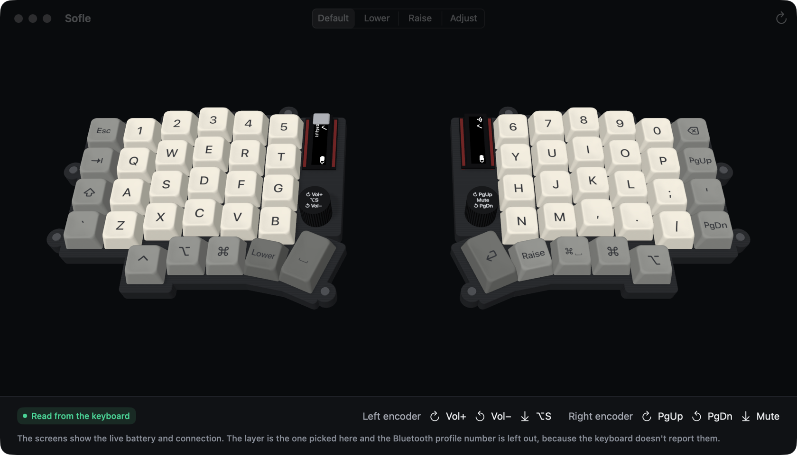

# Sofle (menu bar app)

A macOS menu bar app for this keyboard. It reads everything from the keyboard itself and never changes it.



- **Menu bar:** both halves' battery, for example `93% · 91%`. Click it for the connection state and, per half, the voltage, the drain rate and an estimate of the time left.
- **Keyboard window:** a 3D model of the board (charcoal printed case, XDA caps, portrait OLEDs, knobs). Each cap shows its binding on the layer you pick, each knob shows what turning and pressing it does, and both screens are drawn like ZMK's stock status screen.

English and Brazilian Portuguese, following the system language. Needs macOS 15 or later.

## Build

Needs Xcode (Swift 6). No other dependencies.

```sh
./build.sh
```

This writes `build/Sofle.app`, signed ad hoc. Tests: `swift test`.

## Run

```sh
open build/Sofle.app
```

The app has no Dock icon; look for the keyboard icon in the menu bar. Copy `Sofle.app` to `/Applications` to keep it, and add it under System Settings › General › Login Items to start it at login.

`open build/Sofle.app --args --window` opens the keyboard window at launch.

### First launch

- **Bluetooth:** macOS asks to let Sofle use Bluetooth. Allow it. If you said no, turn it on under System Settings › Privacy & Security › Bluetooth. The signature is ad hoc, so macOS can ask again after you rebuild.
- **Gatekeeper:** an app you built yourself opens normally. If you copied the app from another Mac and macOS refuses to open it, right-click it and choose Open, or allow it under System Settings › Privacy & Security.

## How it reads the keyboard

The keyboard has to be paired with this Mac and named `Sofle`.

| What | From |
|---|---|
| Battery | The two Bluetooth Battery Level characteristics. The one with a "Peripheral 0" description is the right half. |
| Keymap and key positions | ZMK Studio's RPC protocol, on the left half: over Bluetooth, or over the USB serial port while the left half is plugged in. ZMK answers Studio only on the output it is typing on. |
| Encoders | `config/sofle.keymap` on GitHub. Studio doesn't expose `sensor-bindings`. |

The app can only build three Studio requests: get keymap, get physical layouts and get behavior details. It has no code to set, save, discard or reset anything.

If the keyboard doesn't answer, the window shows `config/sofle.keymap` from GitHub (or, offline, the copy taken at build time) and says it is a snapshot from the repository. The reload button in the toolbar reads the keyboard again.

`build/Sofle.app/Contents/MacOS/Sofle --dump` prints what the app read as JSON.

## Limits

- **Time left** is a straight line through the readings since the battery last stopped rising. ZMK reports whole percent steps about once a minute, so the app shows "Estimating…" until the level has dropped 2 points over at least 30 minutes. Time with the keyboard asleep counts as use, so the estimate runs long. Nothing is shown while charging.
- **Voltage** is worked back from the percentage: ZMK only sends percent, computed in a straight line from 3.45 V (0%) to 4.2 V (100%), so each percent is 7.5 mV. `0%` means 3.45 V or less, which is low but not dead: the controller keeps running until the battery's protection cuts out near 3.0 V.
- **Screens:** the keyboard doesn't report its active layer or Bluetooth profile number. The left screen shows the layer picked in the window, and the profile number is left out.
- **Right half:** it reports 0% through the left half while it is off or out of range, so the app shows 0% as "Off or out of range".
- **USB:** plugging or unplugging the cable isn't noticed until the next reload or reconnect.

## Code

| File | Purpose |
|---|---|
| `Sources/Sofle/Keyboard.swift` | Bluetooth, USB serial and the Studio request queue |
| `Sources/Sofle/Studio.swift` | Studio framing and the protobuf messages the app uses |
| `Sources/Sofle/Labels.swift` | Binding names (ported from `tools/studio-to-keymap.ts`), keycap legends, `sofle.keymap` parser |
| `Sources/Sofle/Battery.swift` | Time-left estimate and voltage |
| `Sources/Sofle/Board.swift` | The 3D model (SceneKit) |
| `Sources/Sofle/Screens.swift` | The simulated OLEDs |
| `Sources/Sofle/Views.swift` | Menu bar panel and keyboard window |
| `Sources/Sofle/KielUI.swift` | Design tokens and components |
| `Resources/` | `Info.plist` and the string catalogs |
